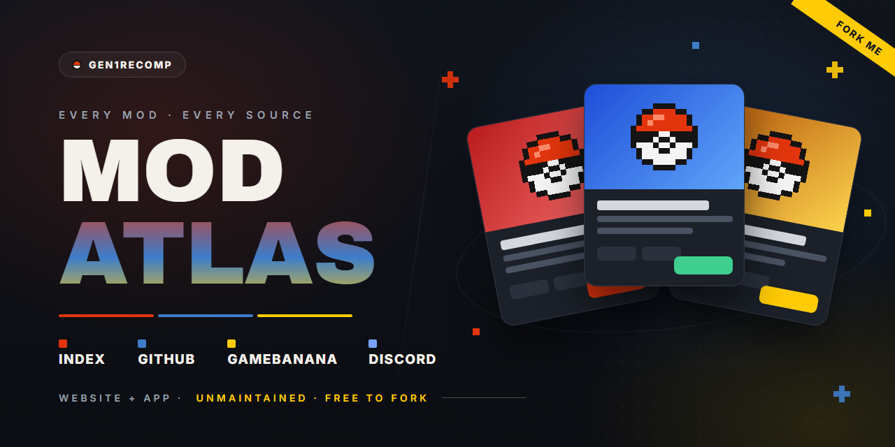
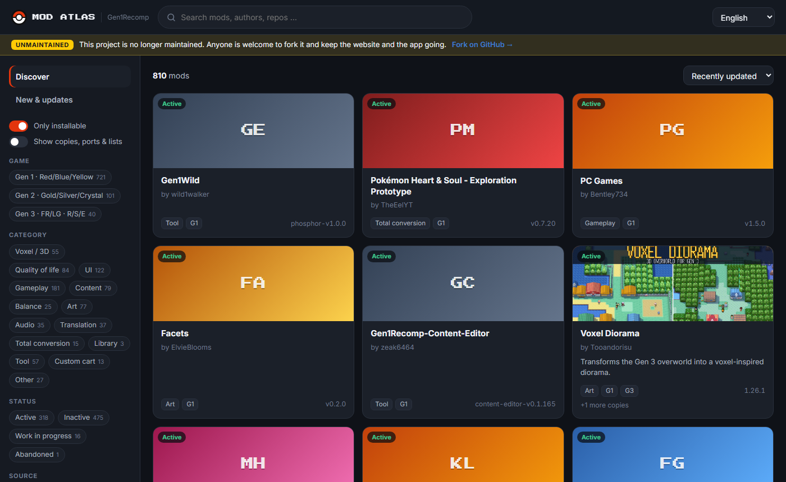
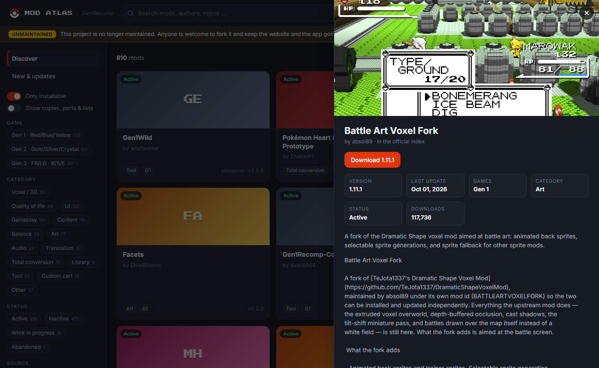

<p align="center"></p>

# G1R Mod Atlas

Every mod for [Gen1Recomp](https://github.com/bryanthaboi/gen1recomp) in one place – from the official mod index,
GitHub, GameBanana and the BOI'S CLUB Discord, including mods that were abandoned or deleted.
As a **website** and as a **Windows app** that installs and updates mods for you.

*Alle Mods für Gen1Recomp an einem Ort – als Webseite und als Windows-App. Das Projekt wird nicht mehr
weiterentwickelt und darf gern geforkt und weitergeführt werden.*

> [!IMPORTANT]
> **This project is no longer maintained.**
> Everything works as it is, but nobody is actively developing it anymore.
> If you want to keep it going – the website, the app or both – **please fork it and make it yours.**
> No need to ask. See [Taking it over](#taking-it-over).

## What it does

- **One list of every mod** – about 900 mods from four sources, merged into one entry per mod
- **No duplicates** – a mod that is on Discord, GitHub, GameBanana *and* in the index shows up once,
  always with its newest version; copies, forks and mirrors are listed under it
- **Abandoned mods stay findable** – deleted repos keep their entry with links to archives and forks
- **Filters** – game (Gen 1 / 2 / 3), category, status (active, inactive, work in progress, abandoned, deleted), source
- **5 languages** – English, Deutsch, Español, Português, Français
- **Windows app** – install, update and remove mods with one click, check all updates at once, start the game
- **In-game index** – a feed in the official index format, so the game's own MODS screen can list the mods
  that are *not* in the official index

## Screenshots

<p align="center"></p>
<p align="center"></p>

## Use it

| | |
|---|---|
| **Website** | [fadeymods.github.io/G1R-Mod-Atlas](https://fadeymods.github.io/G1R-Mod-Atlas/) |
| **Windows app** | `G1R Mod Atlas.exe` from the [latest release](https://github.com/FadeyMods/G1R-Mod-Atlas/releases/latest) – no install needed |
| **Inside the game** | In Gen1Recomp open **MODS**, add an extra index and enter `FadeyMods/G1R-Mod-Atlas` |

The app finds the game's save folder and `gen1recomp.exe` by itself; both can be changed in the settings.
Mods go into the save folder's `mods/` folder, exactly where **Import mod .zip** puts them.
Removed mods and replaced old versions are moved to `%APPDATA%\G1R Mod Atlas\entfernt` – nothing is deleted.

## Sources

| Source | How | Automatic |
|---|---|---|
| Official mod index | `data/index.json` | yes |
| Pull requests to the index (also unmerged) | GitHub API | yes |
| GitHub | repository search + code search (`manifest.json`, README, Lua) | yes |
| GameBanana | public API, Gen1Recomp section | yes |
| BOI'S CLUB Discord | collected once into `seed/discord-threads.txt` | no – needs a Discord bot (see below) |

A GitHub Action runs every day, refreshes every mod and commits the result to `docs/data/`.

## How duplicates are found

Entries are merged when they share

1. the **mod id** from `manifest.json` – the same id is the same mod for the game
2. the **real repository** – renamed accounts and repos are followed
3. the **same download file**
4. a **Discord thread or GameBanana page** that belongs to a GitHub / index entry
5. a **checked decision** in [`crawler/overrides.json`](crawler/overrides.json)

The entry with the newest release becomes the main entry. Different mods with the same name
(different author *and* different mod id) stay separate, and so do the Gen 1 / 2 / 3 versions of a mod.
`python crawler/audit.py` prints a report of everything that was merged and every pair that still looks similar.

## Status

| Status | Meaning |
|---|---|
| Active | updated within the last 45 days |
| Inactive | 45 to 120 days without an update |
| Work in progress | no download yet, or only in the WIP forum |
| Abandoned | more than 120 days without an update, or marked discontinued / retired |
| Archived | archived on GitHub |
| Deleted | repository is gone – the entry stays with its last known state |

## Taking it over

1. **Fork** this repository.
2. **Settings → Pages:** branch `main`, folder `/docs`.
3. **Settings → Actions → General:** workflow permissions "Read and write".
4. **Actions → "Crawl and update mods" → Run workflow** once. From then on it runs daily.
5. In [`app/main.py`](app/main.py) set `DEFAULT_FEED` to your Pages address and build the app:
   `powershell -ExecutionPolicy Bypass -File app\build.ps1` → `app\dist\G1R Mod Atlas.exe`.
6. In [`docs/index.html`](docs/index.html) point the "Fork on GitHub" link to your repo – or remove the
   unmaintained notice if you keep it going.

Ideas that were never finished:

- **Discord bot** – new mods that are only posted on Discord are not found automatically. A small bot that reads the
  mods and WIP forums (added by the server admins) would close that gap.
- **Thumbnails** for mods that are not in the official index.
- **Forks without the mod id** – about 230 repos keep their `manifest.json` deep in a subfolder; reading it from the
  release zip would make duplicate detection even stricter.

## Project layout

```
crawler/atlas.py       crawler (Python standard library only)
crawler/organize.py    duplicate detection, in-game feed
crawler/classify.py    category, gen and status detection
crawler/audit.py       duplicate report
crawler/overrides.json checked same / different decisions
crawler/config.json    search queries, thresholds, exclusions
seed/                  starting data (collected October 2026)
docs/                  website (GitHub Pages) + docs/data/
app/                   Windows app (pywebview + PyInstaller)
assets/                banner source and screenshots
```

Run locally:

```bash
python crawler/atlas.py crawl          # search all sources and refresh every mod
python crawler/atlas.py organize       # only re-run duplicate detection
python -m http.server -d docs 8000     # website on http://localhost:8000
```

With `GITHUB_TOKEN` set the crawler uses the GitHub API (search, forks, stars). Without it, it falls back to the
public GitHub feeds.

## Disclaimer

Unofficial community project, not affiliated with Gen1Recomp, its developers or Nintendo / Game Freak.
The list only links to mods; every mod belongs to its author. Code: [MIT](LICENSE).
